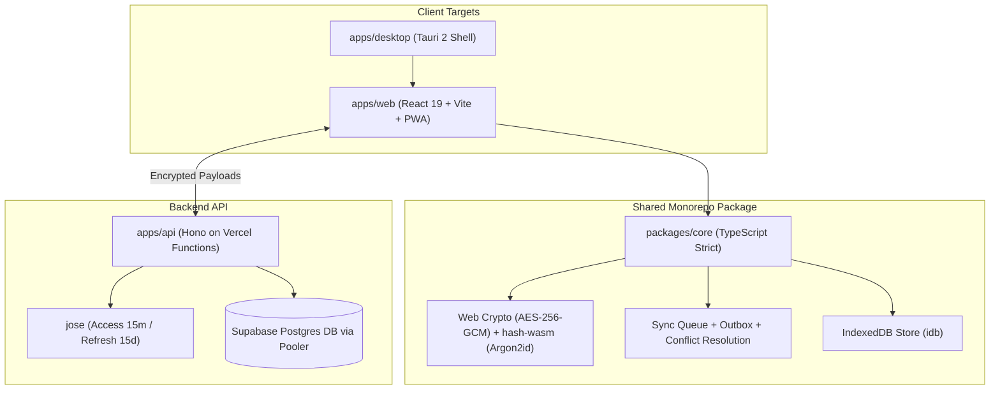

# Implementation Plan: Notepad Cloud

A pixel-faithful replica of Windows 11 Notepad featuring plain & rich text editing, tabs, menus, formatting toolbar, status bar, Google sign-in with custom JWT/refresh tokens, client-side end-to-end encryption (Web Crypto AES-256-GCM + Argon2id), offline PWA with IndexedDB, background cloud sync over Hono + Supabase Postgres, responsive fluid adaptation, and Tauri 2 desktop shell.

---

## User Review Required

> [!IMPORTANT]
> - **Architecture:** "One Codebase, Two Targets" — the exact same React 19 web build (`apps/web`) runs in browsers as an installable PWA and inside a native Windows Tauri 2 desktop wrapper (`apps/desktop`).
> - **Strict Replica Mode:** Visual UI directly mirrors the `reference/` images. As noted in `reference/unwanted.png`, the AI/Copilot button and feedback button are excluded from the build.
> - **Authentication & Backend:** Google sign-in is built with custom PKCE & JWT rotation over Hono (`apps/api`) on Vercel Functions and Postgres. Supabase Auth and Supabase Client SDK are **not** used; Supabase serves strictly as pure PostgreSQL.

---

## Architecture & Technology Stack

---

## Phased Roadmap

### Phase 1: Foundations
* Monorepo setup with pnpm workspaces (`packages/core`, `apps/web`, `apps/desktop`, `apps/api`).
* Supabase PostgreSQL migrations for notes, vaults, and sync outbox.
* Hono API server boilerplate with Vercel serverless integration.
* Core cryptographic primitives (AES-256-GCM and Argon2id) and IndexedDB client storage.

### Phase 2: Auth
* Google sign-in via OAuth 2.0 PKCE flow.
* Token issuance: 15-minute access JWT (memory) and 15-day rotating refresh token (httpOnly cookie).
* First-launch sign-in screen and right toolbar account dropdown.

### Phase 3: Notepad Shell
* Pixel-perfect Windows 11 Notepad chrome: Title bar, tab strip with reordering and Ctrl+Tab.
* Menu bar: File, Edit, View menus matching exact reference layout.
* Center formatting toolbar: Heading, List, Bold, Italic, Strikethrough, Link, Table, Clear formatting.
* Dual editor surface: CodeMirror 6 (Plain text) and TipTap (Markdown rich text).
* Status bar with Ln, Col, character count, encoding, CRLF, and zoom.
* Full keyboard shortcut dispatcher.
* Local auto-save to IndexedDB (1s debounce, 10s max wait).

### Phase 4: Encryption
* User vault initialization with passphrase and Argon2id key derivation.
* Display-once recovery key modal.
* Envelope encryption: notes encrypted before touching IndexedDB or network.

### Phase 5: Sync
* Client sync queue / outbox with retry backoff and jitter.
* Backend sync push/pull endpoints with UUIDv7 note IDs.
* Background sync worker and status-bar sync indicators (Saving, Saved, Offline, Sync failed).
* Conflict handling: losing note version opened as a "[Note] - conflict" tab.
* Multi-tab coordination via BroadcastChannel.

### Phase 6: Offline & PWA
* Service worker caching via `vite-plugin-pwa`.
* Offline app launch and local-first editor initialization.

### Phase 7: Responsive
* Responsive fluid layout from 320px upwards with zero horizontal scroll.
* Horizontal scrolling tab strip and toolbar below 1024px.
* Menu collapse to single consolidated menu button below 600px.
* Touch target sizing (44x44px minimum) and visualViewport virtual keyboard caret handling.
* Dual-screen fold handling with `viewport-segments`.

### Phase 8: Hardening
* Strict Content Security Policy (CSP) and sanitization of rendered markdown and links.
* API rate limiting and Zod input validation on all endpoints.
* Account deletion and data purge workflows.

### Phase 9: Desktop
* Tauri 2 Windows shell wrapping `apps/web`.
* OS keychain integration for secure desktop token persistence.
* Native Windows file open/save dialogs and deep-linking for Google sign-in.

---

## Traceability Matrix (01-scope.md to Tasks)

| Scope Item | Description | Implementing Task IDs |
| :--- | :--- | :--- |
| **A1** | Title and tab strip (tabs, unsaved dot, close, new-tab +, drag reorder, Ctrl+Tab) | `T-011`, `T-012` |
| **A2** | Menu bar (File, Edit, View) | `T-013` |
| **A3** | File menu (New tab, New window, Open, Save, Save as, Save all, Print, Close tab, Close window) | `T-014` |
| **A4** | Edit menu (Undo, Redo, Cut, Copy, Paste, Delete, Find, Find next/prev, Replace, Go to, Select all, Time/Date) | `T-015` |
| **A5** | View menu (Zoom in/out, Default zoom, Status bar toggle, Word wrap toggle) | `T-016` |
| **A6** | Formatting toolbar (Heading, List, Bold, Italic, Strikethrough, Link, Table, Clear formatting) | `T-017`, `T-018`, `T-019`, `T-020` |
| **A7** | Right toolbar (Account button, settings button) | `T-010` |
| **A8** | Editor surface (Text entry, selection, undo, find & replace bar, go-to-line, zoom, word wrap) | `T-022`, `T-024` |
| **A9** | Status bar (Ln, Col, char count, mode label, zoom %, line ending, encoding) | `T-025` |
| **A10** | Settings page (Theme, font family, font size, word wrap, spell check, autocorrect) | `T-021` |
| **A11** | Keyboard shortcuts identical to Windows Notepad | `T-026` |
| **A12** | Rich text & Markdown storage (Headings, lists, bold, italic, tables, links) | `T-023`, `T-043` |
| **B1** | Google sign-in and registration (First launch screen, account menu, sign out) | `T-006`, `T-007`, `T-008`, `T-009`, `T-044`, `T-045`, `T-047` |
| **B2** | Vault unlock (Passphrase, recovery key shown once, plain Notepad styling) | `T-004`, `T-029`, `T-030`, `T-031` |
| **B3** | Auto-save, offline use, background sync (Status bar indicators: Saving, Saved, Offline, Sync failed) | `T-002`, `T-003`, `T-005`, `T-027`, `T-032`, `T-033`, `T-034`, `T-037`, `T-038` |
| **B4** | Saved notes as tabs, File Open list, Save sync, Save as export, local .txt/.md import | `T-028`, `T-048` |
| **B5** | Sync conflict tab ("[Note] - conflict"), multi-tab messaging | `T-035`, `T-036` |
| **B6** | Responsive layout rules in 03-design.md & desktop shell | `T-001`, `T-039`, `T-040`, `T-041`, `T-042`, `T-046` |

---

## Verification Plan

### Automated Testing
* **Unit Tests (`pnpm test`):** Vitest testing crypto round-trip, debounce timing, sync conflict resolution, token rotation, and markdown serialization.
* **Typecheck (`pnpm typecheck`):** TypeScript strict check across all packages with zero errors.
* **Linting (`pnpm lint`):** ESLint verification with zero warnings.
* **E2E Tests (`pnpm test:e2e`):** Playwright automated browser tests for auto-save, offline sync, multi-tab conflicts, and auth flows.

### Visual & Parity Verification
* **UI Parity Check:** Using the `ui-parity-check` skill to compare screenshots against `reference/` images with zero allowed variance.
* **Viewport Sweep:** Using the `viewport-sweep` skill across all 12 viewports in `03-design.md`, including dark mode and touch emulation.
* **Evidence Archival:** Using the `task-evidence` skill to record raw terminal outputs and screenshot analyses under `qa/evidence/<task-id>/`.
